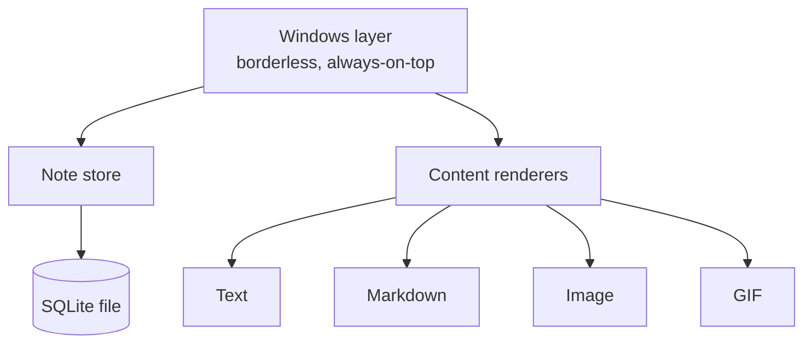

<div align="center">

# 📌 Tack

**Sticky notes that stay where you stick them.**


-blue)

</div>

> **Status:** Early stage: scaffold and docs only.

## 🗒️ What is Tack?

Tack is a small desktop sticky-notes utility I'm writing in Rust, for my own daily use. Notes are small borderless windows that stay on screen where I put them, even through reboots, like paper notes stuck to a monitor.

What I want to do differently is **custom windows**. A window doesn't have to be a text note. It can hold a Markdown file, an image, or a GIF, pinned anywhere on screen like items on an office cubicle wall. Stickers are in scope too.

Tack is inspired by classic desktop sticky-note utilities. It is built from scratch, is not a fork of anything, and is not affiliated with any of them.

## ✨ Features

| Tier | What's in it |
| --- | --- |
| **MVP** | Borderless always-on-top note windows, text, position/size/content saved to SQLite and restored after restart, note colors, close and hide |
| **Differentiator** | Custom windows for image, GIF, and Markdown files, plus stickers |
| **Next** | Snapping to notes and screen edges, resizing, saved styles, hide-until / recurring wake-up reminders, alarms, text or image content, Unicode/RTL |
| **Later / maybe** | Attach a note to an app, site, document, or folder; hierarchical sharing / friends |

Full list, including what is cut for now, in [docs/features.md](docs/features.md).

## 🧭 Design principles

- **Small and simple.**
- **One database file.** Everything lives in a single SQLite file.
- **No registry or system changes.**
- **Unicode and RTL first.** Bangla and right-to-left text should work properly.
- **Notes stay where I put them.**

## 🏗️ Planned architecture

The UI approach is undecided (see [docs/decisions.md](docs/decisions.md)), so this is a sketch.



<details>
<summary><b>📁 Directory layout</b></summary>

```
tack/
  src/        Rust source (written later)
  tests/      Tests
  assets/
    fonts/    Fonts
    icons/    Icons
    stickers/ Stickers
  docs/       Architecture, features, data model, decisions, notes, roadmap
  .gitignore
  README.md
```

</details>

<details>
<summary><b>📚 Docs</b></summary>

- [architecture.md](docs/architecture.md)
- [features.md](docs/features.md)
- [data-model.md](docs/data-model.md)
- [decisions.md](docs/decisions.md)
- [design-notes.md](docs/design-notes.md)
- [platform-notes.md](docs/platform-notes.md)
- [roadmap.md](docs/roadmap.md)

</details>

## 🗺️ Roadmap

- [ ] UI experiment: render Bangla and RTL text in each candidate toolkit
- [ ] MVP notes
- [ ] Persistence
- [ ] Custom windows
- [ ] Snapping
- [ ] Reminders

## 🖼️ Screenshots

*TBD once it exists.*

---

No license is included; all rights reserved.
